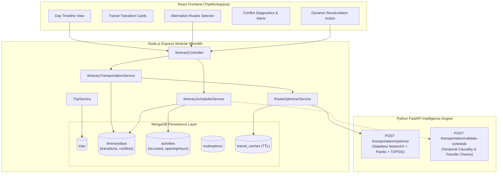

# GANTAVYA — SUB-MILESTONE 2.4.4
# TECHNICAL ASSESSMENT & ARCHITECTURE SPECIFICATION
## Itinerary Integration & Transit Scheduling

**Date:** November 10, 2026  
**Document Version:** 1.0.0  
**Status:** Approved for Implementation  
**Baseline Test Suite Status:** 210/210 passing (161 backend vitest, 41 intelligence pytest, 8 frontend vitest)

---

## 1. Executive Summary & Objective

The objective of **Sub-Milestone 2.4.4** is to bridge Gantavya's multimodal route optimization engine (delivered in Sub-Milestones 2.4.1–2.4.3) with the itinerary planning and group collaboration framework (delivered in Milestone 2.3).

In previous milestones:
- **Sub-Milestone 2.4.1** established the unified domain model (`TransitLeg`, `RouteOption`, `TransportNode`, `FareBreakdown`, `DataFreshness`).
- **Sub-Milestone 2.4.2** implemented external provider adapters (HERE Road v8, Amadeus Flight Offers v2, Indian Railways schedule provider) with a MongoDB TTL-indexed cache (`transit_caches`).
- **Sub-Milestone 2.4.3** built the time-dependent directed multigraph engine in NetworkX, candidate pathfinding, Pareto dominance pruning, and TOPSIS multi-criteria ranking, outputting 5 standard recommendation categories (`cheapest`, `fastest`, `fewest_transfers`, `most_convenient`, `best_overall`).

Sub-Milestone 2.4.4 embeds transit into the living itinerary. Transportation is neither an isolated recommendation nor a disconnected query; it connects activities, accommodations, days, and destinations across multi-day journeys with group preferences, temporal causality, conflict detection, and dynamic recalculation.

---

## 2. Existing Repository Architecture & Inventory

Thorough inspection of the existing repository reveals the following architecture:

### 2.1 Backend Modular Monolith (`backend/src/modules/`)
1. **Trips Module (`trips/`)**:
   - `trip.model.js`: Defines `Trip`, `Participant` (roles: `owner`, `organizer`, `editor`, `viewer`), `Invitation`, and `TravelConstraints` (budget, travel speed, activity density, accessibility requirements).
   - `trip.service.js`: Manages trip lifecycle, RBAC permissions (`verifyTripEditAccess`), participant invitations, and triggers initial itinerary generation via `generateItinerary()`.
2. **Itineraries Module (`itineraries/`)**:
   - `itinerary-day.model.js`: Defines `ItineraryDay` linked to `tripId`, with `dayNumber`, `calendarDate`, `title`, `notes`, `estimatedExpenditure`, `travelDistanceKm`, `travelDurationMinutes`.
   - `itinerary.service.js`: Handles day creation, updates, calendar date boundary validation against trip start/end, and day reordering.
   - `itinerary.controller.js` & `itinerary.routes.js`: Exposes REST endpoints (`/api/v1/itineraries`).
3. **Activities Module (`activities/`)**:
   - `activity.model.js`: Defines `Activity` linked to `itineraryDayId` and `tripId`, with `placeId`, `title`, `startTime`, `endTime`, `durationMinutes`, `sequence`, `estimatedCost`, `travelTimeToNextMinutes`, `travelDistanceToNextMeters`, `status`.
   - `activity.service.js`: CRUD, sequence reordering, and trip permission checks.
4. **Transportation Module (`transportation/`)**:
   - `RouteOptimizerService` (`route-optimizer.service.js`): Coordinates candidate leg fetching across adapters (`TransportationProviderService`), MongoDB TTL cache (`transit-cache.service.js`), and calls FastAPI `/transportation/optimize` with resilient fallback.
   - `RouteOption` (`route-option.model.js`): Stores multi-leg journeys, monetary cost, duration, transfers, scores, category (`cheapest`, `fastest`, etc.).
   - Adapters (`here-road.adapter.js`, `amadeus-flight.adapter.js`, `railway.adapter.js`).

### 2.2 Intelligence Engine (`intelligence/`)
- Stateless FastAPI service running Python 3.11 with NetworkX, Google OR-Tools, and Pydantic v2.
- `app/api/v1/endpoints/transportation.py`: `/transportation/optimize` executes graph construction, Pareto filtering, and TOPSIS ranking.
- `app/api/v1/endpoints/planning.py`: `/planning/plan` provides deterministic day and activity sequencing.

### 2.3 Frontend Application (`frontend/src/`)
- React 18 with Vite and Tailwind CSS.
- `components/TripWorkspace.jsx`: Primary trip workspace supporting day switching, activity viewing/adding, invitation handling, and itinerary generation.
- `services/trip.service.js`: Axios HTTP client for trip, itinerary, and activity endpoints.

---

## 3. Integration Points & System Architecture



---

## 4. Schema & Data Model Gap Analysis

To support seamless transit scheduling and timeline rendering without breaking existing data contracts or 210 existing tests:

### 4.1 Schema Extensions for `ItineraryDay` (`itinerary-day.model.js`)
We extend `ItineraryDay` with:
1. `transitions`: Array of `ItineraryTransitionSchema`:
   - `transitionId`: String (UUID)
   - `fromType`: String (`'destination'`, `'activity'`, `'accommodation'`, `'custom'`)
   - `fromId`: ObjectId / String
   - `fromLocation`: `TransportNodeSchema`
   - `toType`: String (`'destination'`, `'activity'`, `'accommodation'`, `'custom'`)
   - `toId`: ObjectId / String
   - `toLocation`: `TransportNodeSchema`
   - `departureTime`: Date
   - `arrivalTime`: Date
   - `isOvernight`: Boolean
   - `arrivalDayNumber`: Number
   - `selectedCategory`: String (`'best_overall'`, `'cheapest'`, `'fastest'`, `'fewest_transfers'`, `'most_convenient'`)
   - `selectedRoute`: `RouteOption` subdocument or reference
   - `alternativeRoutes`: Array of candidate `RouteOption` subdocuments
   - `bookingStatus`: String (`'unbooked'`, `'reserved'`, `'ticketed'`, `'confirmed'`)
   - `isLocked`: Boolean (prevents automated shifting during recalculation)
2. `accommodations`: Array of accommodation stay references:
   - `accommodationId`: String / ObjectId
   - `name`: String
   - `location`: `TransportNodeSchema`
   - `checkInTime`: String (e.g., `'14:00'`)
   - `checkOutTime`: String (e.g., `'11:00'`)
   - `bookingReference`: String
3. `conflicts`: Array of detected scheduling conflicts:
   - `conflictId`: String
   - `conflictType`: String
   - `severity`: String (`'error'`, `'warning'`)
   - `message`: String
   - `affectedEntityIds`: Array of Strings
   - `suggestedAction`: String
4. `hasConflicts`: Boolean (default: false)

### 4.2 Schema Extensions for `Activity` (`activity.model.js`)
We extend `Activity` with:
1. `isLocked`: Boolean (default: false) — User-fixed activities will never be automatically shifted or rescheduled by transit recalculation.
2. `openingHours`: Subdocument with `{ open: String, close: String }` (e.g. `09:00`, `17:00`).
3. `location`: Subdocument `{ name: String, coordinates: [Number], address: String }`.
4. `transitToNext`: Subdocument storing the active transit transition link to the subsequent event.

### 4.3 Schema Extensions for `Trip` (`trip.model.js`)
We add:
1. `auditTrail`: Array of recalculation and adjustment events:
   - `timestamp`: Date (default `Date.now`)
   - `actorId`: ObjectId / String
   - `action`: String (e.g., `'recalculate_transit'`, `'manual_transit_selection'`)
   - `affectedDayNumbers`: Array of Numbers
   - `summary`: String

---

## 5. Transit Scheduling & Feasibility Rules

The scheduling engine coordinates travel times with activities and accommodations under strict temporal causality:

### 5.1 Temporal Feasibility Equation
For any two consecutive scheduled items $E_i$ and $E_{i+1}$ on the timeline:
$$\text{StartTime}(E_{i+1}) \ge \text{EndTime}(E_i) + \text{TransitDuration}(E_i, E_{i+1}) + \text{BufferMinutes}$$

Where:
- $\text{TransitDuration}$: Duration of the selected multimodal transit option.
- $\text{BufferMinutes}$: Transfer buffer dependent on mode transition (15 min for road/cab, 30 min for regional rail, 60 min for domestic flights, 120 min for international flights).

### 5.2 Conflict Taxonomy (7 Deterministic Conflict Types)
1. `OVERLAPPING_ACTIVITIES`: Activity $A$ overlaps temporally with Activity $B$ on the same day without sufficient transition buffer.
2. `ACTIVITY_DURING_TRANSIT`: Activity is scheduled while the traveler is in transit between locations.
3. `MISSED_CONNECTION`: Arrival of transit leg $L_k$ is later than departure of transit leg $L_{k+1}$ minus the required transfer buffer.
4. `INSUFFICIENT_TRANSFER_BUFFER`: Transfer window between transit modes is smaller than safety minimum (e.g., airport transfer < 45m).
5. `ARRIVAL_AFTER_ACTIVITY_START`: Long-distance or inter-city transit arrives at the destination *after* a scheduled activity has already started.
6. `ACCOMMODATION_CONFLICT`: Hotel check-in attempted before transit arrival at the destination city or after hotel check-in desk closure.
7. `DAY_BOUNDARY_VIOLATION`: Scheduled events exceed permissible active hours (e.g. activity scheduled past midnight on a non-travel day).

---

## 6. Group Travel Constraint Resolution Strategy

When multiple travelers collaborate on a trip, their individual profiles and constraints must be aggregated without deadlock:

| Constraint | Aggregation Policy | Justification |
| :--- | :--- | :--- |
| **Budget Limit** | $\min_{p \in P} (\text{maxBudget}_p)$ or total budget evenly split | Ensures no participant is priced out of group travel options. |
| **Allowed Modes** | $\bigcap_{p \in P} \text{allowedModes}_p$ | If one member cannot fly or refuses rail, only compatible shared modes are considered. |
| **Accessibility** | $\bigcup_{p \in P} \text{accessibilityRequirements}_p$ | If ANY participant requires wheelchair access or step-free transit, the entire group route enforces it. |
| **Travel Speed** | Conservative minimum ($\text{speed} = \text{relaxed}$ takes precedence) | Accommodates slower travelers, ensuring adequate transfer buffers. |
| **Group Size** | Adults + Children + Infants | Direct impact on ticket quantities and vehicle selection (e.g. cab vs SUV vs van). |

---

## 7. Dynamic Recalculation Architecture

When a user modifies a transit choice, locks an activity, or updates timings:
1. **Scope Isolation**: Determine the earliest affected itinerary day. Unaffected prior days remain untouched.
2. **Lock Preservation**: Any activity or transit leg with `isLocked === true` acts as an immovable anchor.
3. **Downstream Shifting**: Flexible activities are shifted forward by $\Delta t$ to accommodate transit delays.
4. **Feasibility Validation**: The scheduler validates the revised schedule against opening hours, check-in windows, and transfer buffers.
5. **Conflict Reporting**: If an immovable locked activity causes an unavoidable overlap, the scheduler flags a high-priority conflict with diagnostic guidance rather than corrupting the user's fixed schedule.
6. **Audit Trail Logging**: Records the recalculation trigger, actor, and affected days.

---

## 8. API Integration Contracts

The following REST endpoints will be implemented under `/api/v1/itineraries`:

```
POST /api/v1/itineraries/:dayId/transportation/integrate
  - Analyzes consecutive locations for the day.
  - Queries RouteOptimizerService.
  - Saves transitions with selected and alternative routes into MongoDB.

GET /api/v1/itineraries/:dayId/timeline
  - Returns unified chronological timeline items:
    { type: 'activity' | 'transit' | 'transfer' | 'accommodation', ... }
  - Includes hasConflicts and conflict details.

POST /api/v1/itineraries/:dayId/validate-timeline
  - Runs conflict detection across activities, transitions, and accommodations.
  - Updates hasConflicts and conflicts in MongoDB.

POST /api/v1/itineraries/:dayId/select-transit-alternative
  - Body: { transitionId, routeCategory: 'cheapest' | 'fastest' | ... }
  - Updates selectedRoute and recalculates downstream items.

POST /api/v1/itineraries/trips/:tripId/recalculate
  - Body: { fromDayNumber, options }
  - Selectively recalculates downstream transitions while preserving locked items.
  - Logs entry in trip audit trail.
```

---

## 9. Comprehensive Testing & 7 Deterministic Scenarios

The test suite will verify the implementation across all layers:
- **Scenario A (Multimodal Chain)**: Raipur $\to$ Delhi $\to$ Jaipur, validating road, rail, and flight legs combined in sequence.
- **Scenario B (Arrival After Start Conflict)**: Transit arrives at 11:00 AM, but scheduled activity is set for 09:30 AM $\to$ flags `ARRIVAL_AFTER_ACTIVITY_START`.
- **Scenario C (Insufficient Transfer Buffer)**: 15-minute connection between international flight and regional train $\to$ flags `INSUFFICIENT_TRANSFER_BUFFER`.
- **Scenario D (Group Constraint Aggregation)**: Participant A (Budget: 5000, No Flights), Participant B (Budget: 8000, Wheelchair) $\to$ resolves to ground transport $\le 5000$ with wheelchair accessibility.
- **Scenario E (Overnight Journey)**: Overnight train departing 22:30 on Day 1 and arriving 07:00 on Day 2 $\to$ correctly assigns arrival to Day 2 timeline.
- **Scenario F (Locked Activity Shift Immunity)**: Changing flight to later time shifts flexible activities but halts at locked activity and reports conflict.
- **Scenario G (Accommodation Check-In Conflict)**: Flight arrives at 23:00, hotel check-in closes at 20:00 $\to$ flags `ACCOMMODATION_CONFLICT`.

---

## 10. Conclusion & Approval

Phase 0 assessment confirms that all required building blocks (`RouteOptimizerService`, `ItineraryDay`, `Activity`, `RouteOption`, provider adapters) are intact, stable, and ready for integration. Implementation can proceed systematically according to the planned phases without breaking backward compatibility or any of the 210 existing tests.

