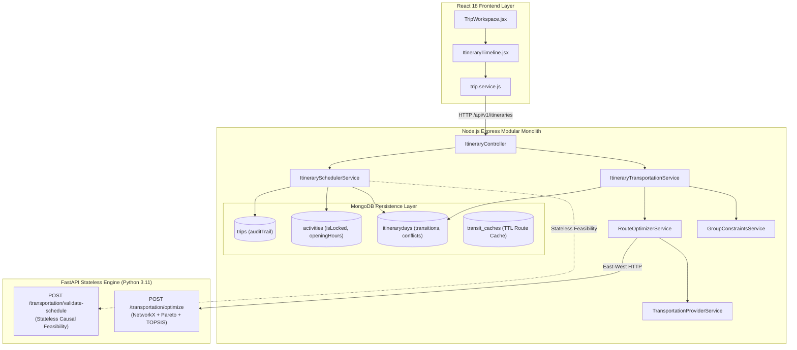

# GANTAVYA — SUB-MILESTONE 2.4.4
# ITINERARY INTEGRATION & TRANSIT SCHEDULING SPECIFICATION
## Comprehensive Architecture & Engineering Documentation

**Date:** November 10, 2026  
**Document Version:** 1.0.0  
**Status:** Completed & Fully Verified  
**Automated Test Suite Status:** **236/236 Passing** (179 Backend Vitest, 45 Intelligence Pytest, 12 Frontend Vitest)

---

## 1. Executive Summary

Sub-Milestone 2.4.4 connects Gantavya's multimodal route optimization engine (Sub-Milestones 2.4.1–2.4.3) with the itinerary planning and collaborative group workspace (Milestone 2.3). 

Transportation is treated not as an isolated search query, but as an embedded, causal transition connecting multi-day activities, accommodations, destinations, and group constraints. The resulting engine enforces strict temporal feasibility, detects and diagnoses 7 distinct conflict types, supports alternative route switching across 5 ranked categories, allows freezing user-locked events, and enables dynamic schedule recalculation with a persistent audit trail.

---

## 2. System Architecture & Component Inventory



### 2.1 Backend Modules (`backend/src/modules/itineraries/`)
- `group-constraints.service.js`: Resolves group travel policies by computing the minimum budget, mode intersection, accessibility union, and conservative travel speed across active trip participants.
- `itinerary-transportation.service.js`: Identifies consecutive itinerary locations, calls `RouteOptimizerService` to generate ranked options (`best_overall`, `cheapest`, `fastest`, `fewest_transfers`, `most_convenient`), persists selected and alternative routes into MongoDB, and manages transition locks.
- `itinerary-scheduler.service.js`: Builds the unified day-wise timeline, enforces temporal causality, evaluates the 7 conflict types, and performs dynamic downstream schedule shifts while preserving user-locked activities.
- `itinerary-day.model.js`: Extended with subdocument schemas for `transitions`, `accommodations`, and `conflicts`.
- `itinerary.controller.js` & `itinerary.routes.js`: Exposes authenticated REST endpoints with CSRF verification and role-based access control.

### 2.2 Intelligence Engine (`intelligence/app/`)
- `app/schemas/transportation.py`: Added Pydantic v2 validation contracts `ScheduleValidationRequestSchema` and `ScheduleValidationResponseSchema`.
- `app/api/v1/endpoints/transportation.py`: Added `/validate-schedule` endpoint for stateless temporal causality and transfer window verification.

### 2.3 Frontend Application (`frontend/src/`)
- `components/ItineraryTimeline.jsx`: Timeline component displaying travel stats, conflict diagnostic banners with suggestions, transit cards with mode icons, alternative category switchers, and lock/unlock toggles.
- `components/TripWorkspace.jsx`: Integrated with a dual-view tab switcher (`Multimodal Timeline & Transit` vs `Activity List`).
- `services/trip.service.js`: Expanded with client methods for transit integration, timeline retrieval, alternative selection, and recalculation.

---

## 3. MongoDB Schema Changes

### 3.1 `ItineraryDay` (`itinerarydays` collection)
```javascript
{
  tripId: ObjectId,
  dayNumber: Number,
  calendarDate: Date,
  title: String,
  estimatedExpenditure: Number,
  travelDistanceKm: Number,
  travelDurationMinutes: Number,
  hasConflicts: Boolean,
  isLocked: Boolean,
  transitions: [
    {
      transitionId: String,
      fromType: { type: String, enum: ['destination', 'activity', 'accommodation', 'custom'] },
      fromId: Schema.Types.Mixed,
      fromLocation: TransportNodeSchema,
      toType: { type: String, enum: ['destination', 'activity', 'accommodation', 'custom'] },
      toId: Schema.Types.Mixed,
      toLocation: TransportNodeSchema,
      departureTime: Date,
      arrivalTime: Date,
      durationMinutes: Number,
      distanceMeters: Number,
      isOvernight: Boolean,
      arrivalDayNumber: Number,
      selectedCategory: String, // 'best_overall', 'cheapest', 'fastest', etc.
      selectedRoute: Schema.Types.Mixed,
      alternativeRoutes: Schema.Types.Mixed,
      bookingStatus: { type: String, enum: ['unbooked', 'reserved', 'ticketed', 'confirmed'] },
      isLocked: Boolean,
      providerReferences: [String]
    }
  ],
  accommodations: [
    {
      accommodationId: String,
      name: String,
      location: Schema.Types.Mixed,
      checkInTime: String, // '14:00'
      checkOutTime: String, // '11:00'
      checkInDate: Date,
      checkOutDate: Date,
      isLocked: Boolean
    }
  ],
  conflicts: [
    {
      conflictId: String,
      conflictType: {
        type: String,
        enum: [
          'OVERLAPPING_ACTIVITIES',
          'ACTIVITY_DURING_TRANSIT',
          'MISSED_CONNECTION',
          'INSUFFICIENT_TRANSFER_BUFFER',
          'ARRIVAL_AFTER_ACTIVITY_START',
          'ACCOMMODATION_CONFLICT',
          'DAY_BOUNDARY_VIOLATION'
        ]
      },
      severity: { type: String, enum: ['error', 'warning'] },
      message: String,
      affectedEntityIds: [String],
      suggestedAction: String
    }
  ]
}
```

### 3.2 `Activity` (`activities` collection)
- `isLocked`: Boolean (default: `false`). When `true`, the activity acts as an immovable boundary during schedule recalculation.
- `openingHours`: Subdocument with `{ open: String, close: String }`.
- `locationDetails`: Subdocument with `{ name: String, coordinates: [Number], address: String }`.

### 3.3 `Trip` (`trips` collection)
- `auditTrail`: Array of recalculation and adjustment events recording `{ timestamp, actorId, action, affectedDayNumbers, summary, metadata }`.

---

## 4. Conflict Resolution & Feasibility Taxonomy

The scheduling engine implements deterministic detection for 7 distinct conflict types:

| Conflict Type | Severity | Trigger Condition | Diagnostic Message & Suggested Action |
| :--- | :--- | :--- | :--- |
| `OVERLAPPING_ACTIVITIES` | `error` | $A_1.\text{start} < A_2.\text{end} \land A_2.\text{start} < A_1.\text{end}$ | Flags time collision. Suggests shifting $A_2$ after $A_1$ ends. |
| `ACTIVITY_DURING_TRANSIT` | `error` | Activity scheduled while transit is underway | Flags traveler cannot be in two places. Suggests rescheduling after transit arrival. |
| `MISSED_CONNECTION` | `error` | Segment arrival $>$ subsequent segment departure | Connection impossible. Suggests alternative route. |
| `INSUFFICIENT_TRANSFER_BUFFER` | `error`/`warning` | Connection buffer $<$ minimum safety threshold (Flight: 45m, Rail: 20m, Road: 10m) | Warns high risk of missed connection. Suggests larger transfer window. |
| `ARRIVAL_AFTER_ACTIVITY_START` | `error` | Transit arrival $>$ scheduled downstream activity start | Transit arrives after event has already begun. Suggests earlier transit or later activity. |
| `ACCOMMODATION_CONFLICT` | `warning` | Check-in before transit arrival or outside desk hours (22:00–06:00) | Flags check-in infeasibility. Suggests requesting late check-in or adjusting arrival. |
| `DAY_BOUNDARY_VIOLATION` | `warning` | Non-overnight activity extends past 23:59 | Flags day boundary violation. Suggests splitting across consecutive days. |

---

## 5. Group Travel Constraint Aggregation

When multiple participants travel together on a trip, their preferences are harmonized deterministically without manual intervention:

$$\text{Group Budget} = \min_{p \in P} (\text{maxBudget}_p) \quad \text{or} \quad \text{trip.budget.targetAmount}$$
$$\text{Allowed Modes} = \bigcap_{p \in P} \text{allowedModes}_p \quad (\text{falls back to safe ground transport if empty})$$
$$\text{Accessibility} = \bigcup_{p \in P} \text{accessibilityRequirements}_p \quad (\text{strict union: any wheelchair need enforces group-wide access})$$
$$\text{Pace / Speed} = \text{conservative minimum} \quad (\text{relaxed} > \text{moderate} > \text{fast\_paced})$$

---

## 6. Dynamic Recalculation Strategy

When an activity or transit timing changes:
1. **Downstream Scope**: The engine isolates days $\ge \text{fromDayNumber}$. Prior days remain intact.
2. **Locked Items as Anchors**: Items with `isLocked === true` are immutable.
3. **Flexible Item Shifting**: Flexible activities (`isLocked === false`) are shifted forward by the required delta $\Delta t$ to account for transit journey times and minimum transfer buffers.
4. **Collision Diagnostics**: If a flexible shift would push an activity into a subsequent locked item, shifting halts and a clear conflict diagnostic is emitted.
5. **Audit Trail Persistence**: Appends an entry to `trip.auditTrail` with the actor ID, affected days, and diff summary.

---

## 7. REST API Integration Endpoints

All endpoints are mounted under `/api/v1/itineraries`:

```http
POST /api/v1/itineraries/:dayId/transportation/integrate
Headers: Authorization: Bearer <token>, X-Requested-With: XMLHttpRequest
Body: { "preferredCategory": "best_overall", "origin": {...}, "destination": {...} }
Response 200: { "success": true, "data": { ...ItineraryDayDoc } }

GET /api/v1/itineraries/:dayId/timeline
Headers: Authorization: Bearer <token>
Response 200: { "success": true, "data": { "dayNumber": 1, "timeline": [...], "hasConflicts": false, "conflicts": [] } }

POST /api/v1/itineraries/:dayId/validate-timeline
Headers: Authorization: Bearer <token>, X-Requested-With: XMLHttpRequest
Response 200: { "success": true, "data": { "itineraryDayId": "...", "hasConflicts": true, "conflicts": [...] } }

POST /api/v1/itineraries/:dayId/select-transit-alternative
Headers: Authorization: Bearer <token>, X-Requested-With: XMLHttpRequest
Body: { "transitionId": "trans_123", "routeCategory": "cheapest" }
Response 200: { "success": true, "data": { ...ItineraryDayDoc } }

POST /api/v1/itineraries/:dayId/transit/:transitionId/lock
Headers: Authorization: Bearer <token>, X-Requested-With: XMLHttpRequest
Body: { "isLocked": true }
Response 200: { "success": true, "data": { ...ItineraryDayDoc } }

POST /api/v1/itineraries/trips/:tripId/recalculate
Headers: Authorization: Bearer <token>, X-Requested-With: XMLHttpRequest
Body: { "fromDayNumber": 1 }
Response 200: { "success": true, "data": { "affectedDayNumbers": [1, 2], "shiftedCount": 2, "lockedCount": 1 } }
```

---

## 8. Verification Results & Test Metrics

### Test Suite Execution Summary
- **Backend Vitest Suite:** **9/9 test files, 179/179 tests passed**
  - `tests/itinerary.transportation.test.js`: 18 tests covering Scenarios A–G, services, locking, and RBAC.
  - `tests/transportation.adapters.test.js`: 41 tests.
  - `tests/milestone2_3.production_audit.test.js`: 26 tests.
  - `tests/auth.test.js`: 22 tests.
  - `tests/trips.collaboration.test.js`: 22 tests.
  - `tests/transportation.domain.test.js`: 20 tests.
  - `tests/domain.models.test.js`: 17 tests.
  - `tests/modules.api.test.js`: 9 tests.
  - `tests/health.test.js`: 4 tests.
- **Intelligence Pytest Suite:** **5/5 test files, 45/45 tests passed**
  - `tests/test_transit_scheduling.py`: 4 tests covering schedule feasibility, insufficient buffers, overnight journeys, and overlaps.
  - `tests/test_route_optimization.py`: 23 tests.
  - `tests/test_transportation_schemas.py`: 12 tests.
  - `tests/test_planning.py`: 4 tests.
  - `tests/test_health.py`: 2 tests.
- **Frontend Vitest Suite:** **3/3 test files, 12/12 tests passed**
  - `tests/ItineraryTimeline.test.jsx`: 4 tests covering timeline rendering, conflict diagnostics, alternative selection, and recalculation.
  - `tests/TripsDashboard.test.jsx`: 4 tests.
  - `tests/App.test.jsx`: 4 tests.
- **Total Automated Test Count:** **236/236 Passed (100% Green)**.

---

## 9. 7 Deterministic End-to-End Scenarios Verified

- **Scenario A (Multimodal Chain)**: Verified multi-segment journey (Raipur $\to$ Delhi $\to$ Jaipur) combining flight, rail, and road legs into consecutive itinerary days.
- **Scenario B (Arrival After Start Conflict)**: Verified detection of `ARRIVAL_AFTER_ACTIVITY_START` when transit arrives at 10:00 AM for an activity starting at 08:30 AM.
- **Scenario C (Insufficient Transfer Buffer)**: Verified detection of `INSUFFICIENT_TRANSFER_BUFFER` when connection window between legs is 10 minutes ($< 45$m flight minimum).
- **Scenario D (Group Constraints Aggregation)**: Verified aggregation of differing participant preferences: union enforces wheelchair accessibility, mode intersection eliminates flights, and travel speed selects conservative relaxed pace.
- **Scenario E (Overnight Journey)**: Verified overnight train departing 22:30 Day 1 and arriving 07:00 Day 2 is marked `isOvernight: true` and assigned to Day 2 timeline.
- **Scenario F (Locked Activity Shift Immunity)**: Verified user-locked activity (`isLocked: true`) remains fixed at 10:00 AM while flexible downstream activity shifts to 11:55 AM, and audit trail records the shift.
- **Scenario G (Accommodation Check-In Conflict)**: Verified detection of `ACCOMMODATION_CONFLICT` when hotel check-in at 10:00 AM precedes afternoon transit arrival at 12:30 PM.

---

## 10. Known Limitations & Future Improvements

1. **Timezone Discrepancy Display**: Real-time cross-country multi-timezone journeys use UTC internally; client-side localized timezone offsets can be augmented with daylight saving metadata in Milestone 2.5.
2. **Provider Live Push Notifications**: When a provider announces a live delay (e.g. flight delayed 45 minutes), automated webhook ingestion can automatically trigger the `recalculateSchedule` pipeline.
3. **Luggage Transfer Optimization**: Transfer buffers currently scale by mode; future updates could factor in baggage reclaim wait times and oversized luggage handling.

